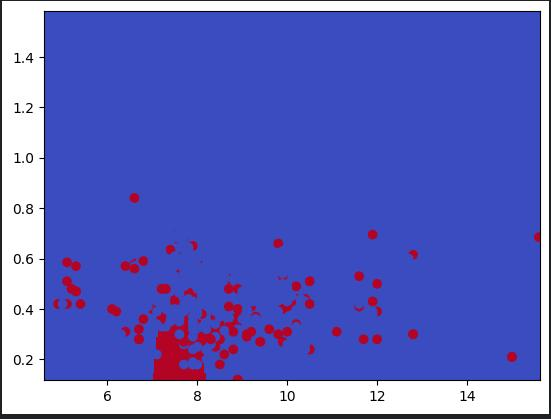

# Wine Quality with SVM Kernel RBF

In this project I have applied SVM RBF Kernel from scratch in [Red wine quality](https://www.kaggle.com/datasets/yasserh/wine-quality-dataset) dataset in kaggle. This markdown is just the overview of poject and how I made this. I have given more details in my [notes](https://github.com/gitbhusalhubpramish/ml-notes/tree/main/0.006%20SVM) about SVM.

This is how this algorithm creates boundries in data - It is in jupiter notebook in this project - It's just the visulization of only 2 feature.

## Small intro to SVM

SVM is a supervised regression bashed classification meachine learning model which uses support vector and decision line to classify data. The decision line shaprate the data into two parts. The approch I used here transfers the data into higher dimention and classify through decision line. The transfer is called Kernel. There are 4 kernel I have used RBF.

## Feature

This project was made by me to understand SVM RBF Kernel from scratch so it has SVM RBF Kernel applied from scratch. But also:

- SVM RBF Kernel from scratch.
- Parellel CPU processing
- Multi-class classification
- Data Visulization.

## Tech-Stack

This project uses python liberies used for datascienct - Visulization, calculation and data manipulation. I've used:

- Numpy for calculation
- matplotlib and streamlit for data visulization
- pandas for CSV and data manipulation
- sk-learn for accuracy calculation and datasplit
- multithreading and multiprocressing

## Work-flow

The work flow of the project looks like this:

- **Fetch data:** Here the data is fetched from kaggle dataset.
- **Data Shepration:** Here the algorithm sharate the data into 2(4) parts for training and testing for each.
- **Parameter initlization:** Here the model's parameter is initlized all to zero.
- **Training:** Here the greadient is calculated and the parameter are updated accordingly by 

$$
\alpha = \alpha - \eta \frac{\partial \mathcal{L}}{\partial \alpha}
$$

- **Loss calculation:** This is done just to see how model is learning the graph in the preview page is the loss graph multiple time.
- **repeat:** repeat to train and calculate error multiple times(epoch)
